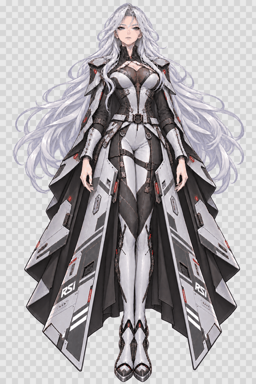

# Perseus_RSI-model — v1.0.0

这是从初版备份保存的历史快照，供下载、对照和回退使用。[最新版 v2.0.0](https://github.com/GAOTAIN/Perseus_RSI-model/releases/tag/v2.0.0)。

## 原始预览

这是参数演示，不是摄像头录制。

## v1 内容

- 原生 Cubism 4.2 运行模型、2048×2048 透明贴图和可编辑 CMO3。
- 18 个参数、4 个 ArtMesh、4 组头发和裙甲物理。
- 基础左右眨眼、说话口型、轻微头身动作和呼吸。
- 冷傲、自信表情与 10 秒待机动作。
- 保留初版角色缩略图及初版脸部素材。

## 使用

解压后把整个 Perseus_RSI 文件夹放到 VTube Studio 的 VTube Studio_Data/StreamingAssets/Live2DModels 目录，打开 VTS 选择模型，首次执行 Auto-Setup 并校准。

[官方导入说明](https://github.com/DenchiSoft/VTubeStudio/wiki/Getting-Started#importing-a-live2d-model)

## 源文件

Source/Perseus_RSI.cmo3 是原始备份；Source/rig.json、图集和构建脚本供重建使用。重建脚本使用保留下来的 v1 素材，已将生成图集与初版运行贴图核对。

在 Source/Build 安装 Node.js 依赖后可运行 npm run art。开源导出器完整源码和许可证位于 Source/Perseus_exporter_source.zip，按包内说明使用 JDK21 构建。

该版本为主体连续网格加闭眼与口型贴片的基础二维绑定。头发和装甲没有全部补绘为独立生产图层，不包含完整侧脸、转身、手部动作或精细发丝分层。

模型来源为爱好者制作项目，RSI 和 Star Citizen 相关标志属于其原权利人。本仓库不是官方模型。验证与来源说明见 Validation/ 和 THIRD_PARTY_NOTICES.md。
