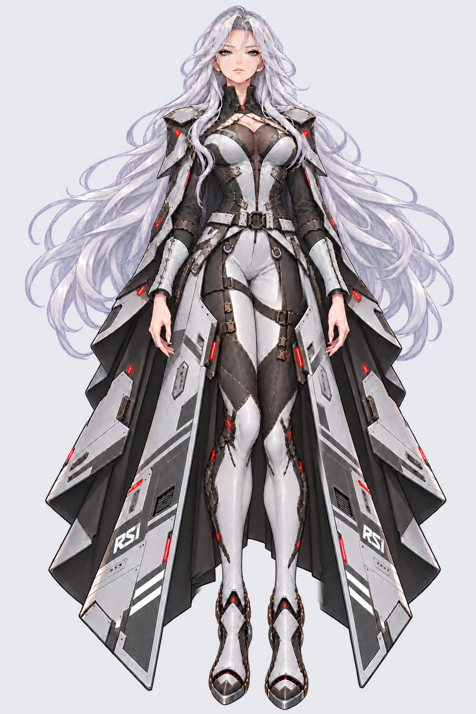
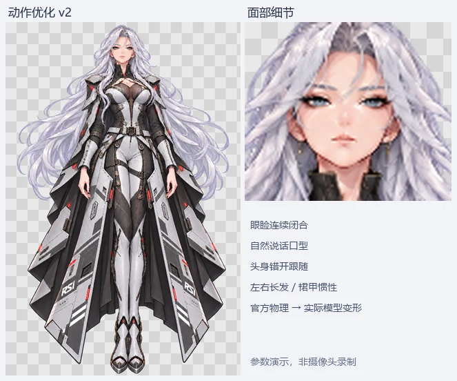

# Perseus_RSI-model

基于 RSI 英仙座主题立绘制作的 VTube Studio 基础 Live2D 模型。当前版本为 **v2.0.1：腿部重绘与自然站姿修订**。

[下载最新版模型与完整项目](https://github.com/GAOTAIN/Perseus_RSI-model/releases/tag/v2.0.1)

## 预览

这次修订重新绘制了膝盖、腿肚和脚踝，加入轻微屈膝并收窄脚距。上半身、脸、双手和裙甲 RSI 标志保留原图像素；小腿和靴子不会被裙甲摆动参数牵动。

上方动画已使用当前模型重新渲染：20fps 的参数输入与官方 Cubism 物理算法驱动实际网格，并非摄像头实录。[腿部调整前后对比](Preview/natural-legs-comparison.png)左侧为上一版本地分腿稿，右侧为当前修订。

## 模型内容

- 原生 Cubism 4.2 `.moc3` 运行模型、2048×2048 透明图集。
- 可编辑 `.cmo3`、绑定 JSON、原画、脸部素材与重建脚本。
- 21 个参数：左右眼睑闭合、连续说话口型、头部 XYZ、身体跟随、呼吸、视线和眉形。
- 7 组物理：刘海以及左右侧发、长发与裙甲，各有不同的惯性节奏。
- 「冷傲」「自信」表情、10 秒待机动作与 RSI 标志模型图标。

## 在 VTube Studio 中使用

1. 下载 Release 中的 `Perseus_RSI-v2.0.1-model.zip`，或下载带源文件的 `Perseus_RSI-v2.0.1-complete.zip`。
2. 解压后把整个 `Perseus_RSI` 文件夹复制到 VTube Studio 的 `VTube Studio_Data/StreamingAssets/Live2DModels` 目录。更新时先备份已有文件夹，保留自己的 `.vtube.json` 配置。
3. 启动或重新加载 VTube Studio，选择 `Perseus_RSI`。首次加载执行 Auto-Setup，然后启用摄像头并校准。
4. Windows 用户也可在关闭 VTS 后，在完整项目目录运行 `Install-Perseus.ps1 -VTubeStudioPath "你的 VTube Studio 安装目录"`。安装脚本会备份已有同名模型，并保留其摄像头校准与快捷键；它会设置图标并调整眼嘴输出范围和平滑。
5. 首次导入由 VTS 生成配置后，若图标未自动识别，关闭 VTS 后再运行一次安装脚本即可设置 `icon.png`。

[官方导入说明](https://github.com/DenchiSoft/VTubeStudio/wiki/Getting-Started#importing-a-live2d-model)

## 编辑与重建

- `Source/Perseus_RSI.cmo3`：模型源文件；已完成编码器加载回读检查，未做官方 Cubism Editor GUI 打开验证。
- `Source/rig.json` 和 `Source/Perseus_atlas.png`：可直接作为附带开源导出器的输入。
- 解压 `Source/Perseus_exporter_source.zip`，按包内说明用 JDK 21 构建；包含所用 Umamo 源码与许可证，不附带缓存或第三方模型。
- 重建素材：在 `Source/Build` 中安装 Node.js 依赖，再运行 `npm run art` 与 `npm run sidecars`。
- `npm run pose` 可从附带的原始立绘与重绘结果恢复腿部合成立绘；采用原尺寸合成，不对腿部压缩或拉伸。输出 `Source/Perseus_reference-natural-pose.png`，如需重新制作图集，将其复制为 `Source/Perseus_reference.png` 后运行 `npm run art`。
- 本次腿部重绘使用内置 ImageGen，完整提示词见 `Source/ImageGen-natural-pose-prompt.json`；口型提示词见 `Source/ImageGen-v2-prompt.json`。

## 当前范围

这是主体连续网格加左右闭眼及口型贴片的基础二维绑定，共 4 个 ArtMesh；头发和装甲没有全部补绘为独立生产图层。转头是有限的二维透视形变，不包含完整侧脸、转身、手部动作或精细发丝分层。

模型通过官方 Live2D Core 5.0 的 MOC 一致性、真实加载与全部参数检查；当前模型动画经实际网格渲染检查，裙甲参数对受保护的 920 个小腿及靴子网格顶点位移为零。物理使用官方 CubismWebFramework 执行验证。尚未进行摄像头面捕测试，追踪表现取决于设备和校准。记录见 `Validation/`。

## 来源

爱好者制作项目。RSI、Star Citizen 及相关标志属于其原权利人；本仓库不是官方模型。第三方素材与导出器信息见 [THIRD_PARTY_NOTICES.md](THIRD_PARTY_NOTICES.md)。历史 v1.0.0 与 v2.0.0 保留在 [Releases](https://github.com/GAOTAIN/Perseus_RSI-model/releases)。
